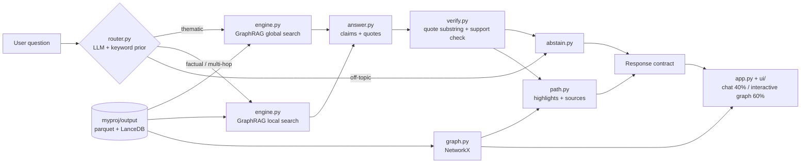

# ThemeGraph

ThemeGraph is a split-screen knowledge-graph Q&A app built on Microsoft GraphRAG. Drop in a small
document corpus, and GraphRAG extracts entities, relationships and themed communities. A router sends each
question to **global search** (themes across the corpus), **local search** (facts and multi-hop links), or
**abstains** when the corpus can't answer. Every answer is split into claims that carry verbatim quotes,
each checked against the source text, and the clickable graph on the right highlights the evidence
path. A benchmark compares the routed pipeline with GraphRAG basic, local-only and global-only search.

## Architecture



All LLM calls go through `backend/llm.py`, which caches responses in SQLite (`cache.db`) and retries with backoff.

## Setup (clean clone to running app)

```powershell
python -m venv .venv
.venv\Scripts\activate            # macOS/Linux: source .venv/bin/activate
pip install -r requirements.txt
copy .env.example .env            # then set GRAPHRAG_API_KEY (an OpenAI key with credits)

.\tasks.ps1 index                 # or: make index   (GraphRAG indexing + schema notes)
.\tasks.ps1 test                  # offline unit tests
.\tasks.ps1 smoke                 # 3 end-to-end questions (needs API key)
.\tasks.ps1 app                   # streamlit run app.py
.\tasks.ps1 mock                  # same app with built-in demo data (MOCK=1), no index or API key needed
.\tasks.ps1 eval                  # benchmark -> eval/results/summary.csv
```

### The UI

- **Chat (left)**: corpus chips and index status, example questions, route badge (hover for reason and
  confidence), streamed answer, claim cards with verified quotes and **Show in graph**, sources, abstain card with
  **Show closest theme**, copy, thumbs feedback, follow-up chips, and a search-mode popover (Auto, Global, Local, Basic).
- **Right tabs**: Graph | Themes | Sources | Compare | Results. The graph is a bidirectional Streamlit component
  (`ui/graph_component`, plain HTML/JS with a vendored `vis-network`, no build step). Click a node for its drawer
  (*Ask about this*, *Expand neighbours*); `/` searches, `F` fits, `Esc` clears; depth slider, community legend,
  evidence replay, fullscreen and PNG export.
- **Demo mode**: `MOCK=1` (or no index in `myproj/output`) loads a 40-node sample graph with canned global, local,
  abstained and 12-node multi-hop answers. Try "What are the main themes?", "What is the Harbor Wind Farm?",
  "How is the Clean Energy Plan connected to the Electric Bus Fleet?" and "What is the capital of France?".
- Component test bench: `streamlit run scripts/graph_component_demo.py` (12-node sample; events shown via `st.write`).

The sample corpus in `myproj/input/` is 10 short documents about a fictional city's clean energy
transition, written with deliberate cross-document links (people, organisations and projects that recur
across documents). To use your own corpus, replace those files or use the upload panel in the app, then delete
`myproj/output` and re-index.

## Environment variables

| Variable | Purpose | Default |
|---|---|---|
| `GRAPHRAG_API_KEY` | LLM key used by GraphRAG and `llm.py` | required |
| `LLM_MODEL_CHEAP` | routing, verification | `gpt-4o-mini` |
| `LLM_MODEL_STRONG` | answer generation, eval judge | `gpt-4o` |
| `LLM_BASE_URL` | optional OpenAI-compatible endpoint for `llm.py` | blank |
| `GRAPH_ROOT` | GraphRAG project folder | `myproj` |
| `ABSTAIN_MIN_SCORE` | minimum retrieval signal (matched entities / reports) | `1` |
| `ROUTER_MIN_CONF` | below this router confidence, fall back to local | `0.5` |
| `COMMUNITY_LEVEL` | community hierarchy level for global/local search | `2` |

## How the requirements are met

| Requirement | Implementation |
|---|---|
| Ingestion | `engine.ingest_files` (txt + PDF via pypdf) into `myproj/input`; upload panel in the app; `engine.run_index` calls `graphrag.api.build_index` |
| Entities and themes | GraphRAG entity/relationship extraction and Leiden communities with LLM community reports; community titles in the sidebar |
| Knowledge graph | `graph.py` builds a NetworkX graph (node = entity, edge = relationship with `text_unit_ids`) and renders it with pyvis |
| Vector store | GraphRAG's LanceDB store (`myproj/output/lancedb`) holds text-unit and entity embeddings used by local and basic search |
| Query router | `router.py`: cheap-model classifier with 8 few-shot examples, keyword prior, confidence fallback |
| Grounded answers | `answer.py` forces claims with verbatim quotes, `verify.py` drops any quote not found in its cited chunk and runs a batched support check, and `abstain.py` declines when nothing survives |
| Split-screen UI | `app.py` + `ui/`: chat with route badges, claim cards and sources on the left; interactive evidence graph (`ui/graph_component`, payload from `graph.to_payload`) plus Themes, Sources, Compare and Results tabs on the right |

**Which store each route reads:** global reads `community_reports` + `communities` parquet; local reads
LanceDB entity embeddings, then `entities`, `relationships`, `text_units` and `community_reports` parquet; basic reads
LanceDB text-unit embeddings. Highlights and sources come from the NetworkX graph and parquet tables.

## Results

Run `.\tasks.ps1 eval` (or `make eval`) and paste `eval/results/summary.md` here.

| system | type | correct | evidence_recall | quote_validity | router_acc | abstain_recall | latency_ms |
|---|---|---|---|---|---|---|---|
| basic | ALL | - | - | - | - | - | - |
| local_only | ALL | - | - | - | - | - | - |
| global_only | ALL | - | - | - | - | - | - |
| routed | ALL | - | - | - | - | - | - |

Metric notes: evidence recall is measured at the document level (`gold_docs` in `eval/questions.jsonl`),
because GraphRAG chunk ids change on every re-index. Correctness is an LLM judge against the reference answer,
with the systems shown in a seeded random order.

## Limitations

- No conflict or contradiction edges: conflicting statements across documents are not detected.
- No incremental ingestion: adding documents means re-indexing the whole corpus.
- Global answers cite community reports (LLM summaries), not raw text, so their quotes are one step removed from the source.
- Local-search source ids are row positions assigned by GraphRAG; sources are mapped to documents by matching chunk text.
- Neo4j and ChromaDB (stretch goal P11) are not implemented; their packages are listed in `requirements-stretch.txt`.

## Project layout

```
backend/   config, contracts, llm, engine, graph, path, router, answer, verify, abstain, pipeline
app.py     Streamlit split screen (thin: wires ui/ modules together)
ui/        state, data (real or mock), chat, themes, sources, compare, styles, mock, graph_component/ (HTML/JS)
eval/      questions.jsonl, run.py, metrics.py, report.py, results/
tests/     offline tests with a fake graph (no API key needed)
scripts/   inspect_output.py, smoke_test.py
docs/      schema_notes.md (generated), graphrag_settings.md, demo_script.md
myproj/    GraphRAG root: settings.yaml, input/, prompts/, output/
```

## Credits

[Microsoft GraphRAG](https://github.com/microsoft/graphrag), [NetworkX](https://networkx.org),
[pyvis](https://github.com/WestHealth/pyvis), [Streamlit](https://streamlit.io), [LanceDB](https://lancedb.com),
[OpenAI Python SDK](https://github.com/openai/openai-python), pandas, pyarrow, pypdf, pydantic.
